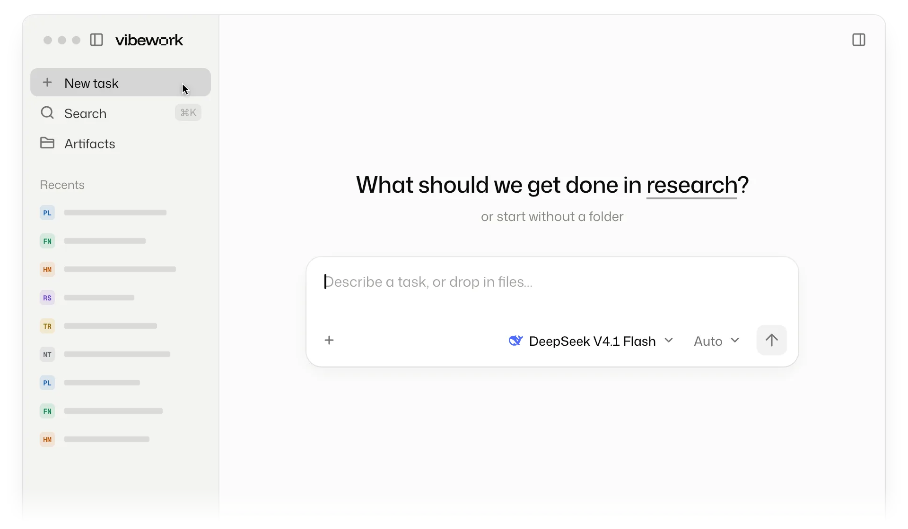
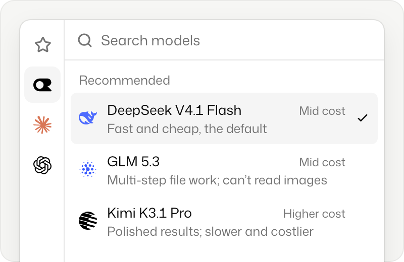
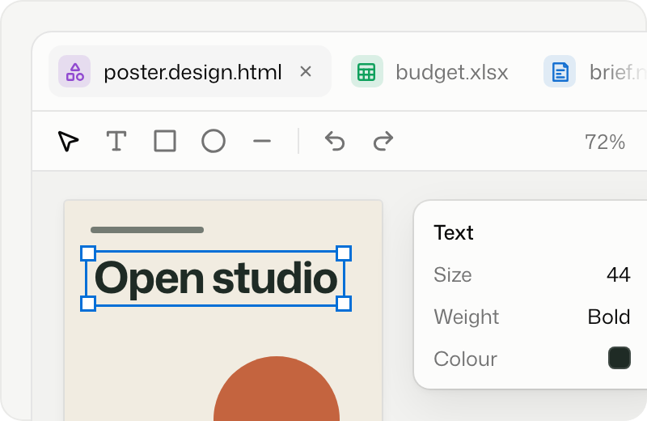
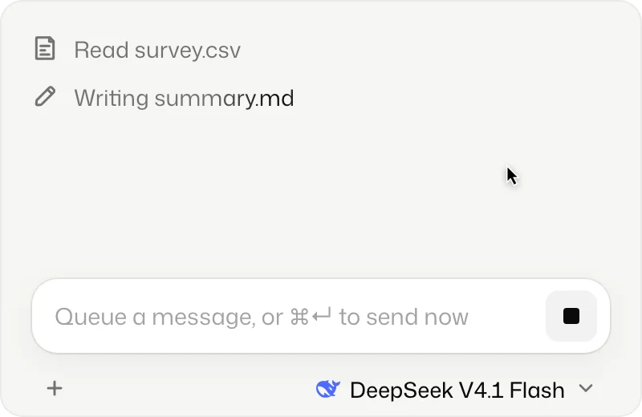
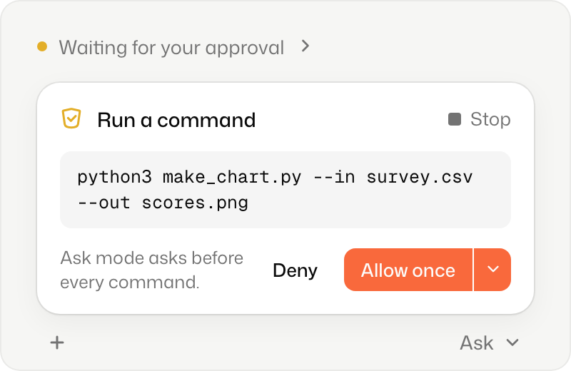
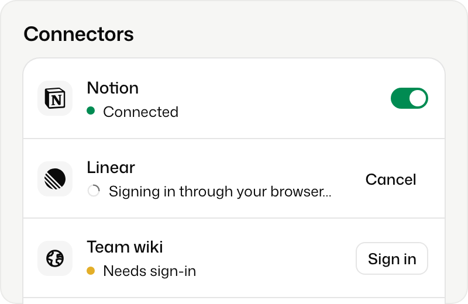
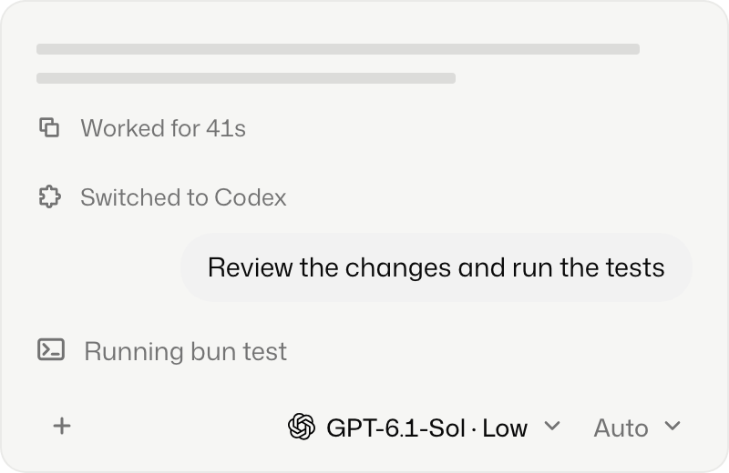
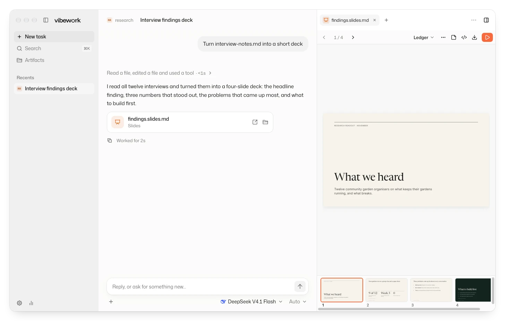
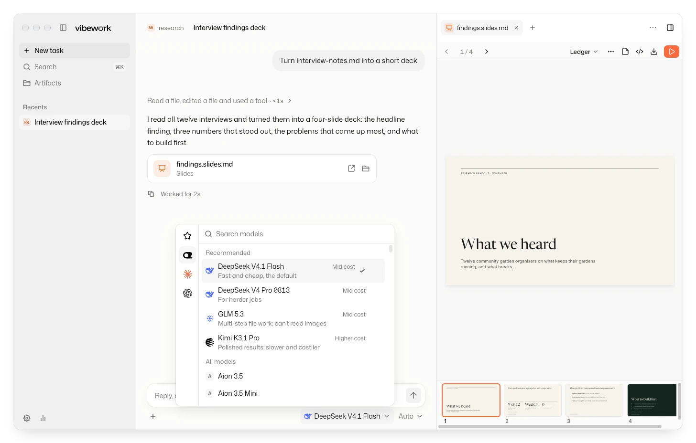
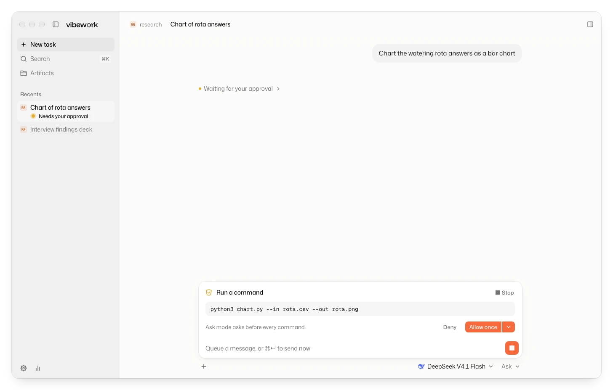

<p align="center">
  <picture>
    <source media="(prefers-color-scheme: dark)" srcset="docs/readme/wordmark-dark.svg">
    
  </picture>
</p>

<h3 align="center">A desktop agent for open models, on your Mac.</h3>

<p align="center">
  Choosing an open model shouldn’t mean settling for a worse app. Vibework works on the files in a folder with any model on OpenRouter, using your own key, and shows what it makes in a panel you can edit.
</p>

<p align="center">
  
  
  
  <!-- Release badge: add after the first published release, e.g. https://img.shields.io/github/v/release/<owner>/<repo>?style=flat-square -->
</p>

<br>

<p align="center">
  <picture>
    <source media="(max-width: 600px) and (prefers-color-scheme: dark)" srcset="docs/readme/hero-compact-dark.webp">
    <source media="(max-width: 600px)" srcset="docs/readme/hero-compact-light.webp">
    <source media="(prefers-color-scheme: dark)" srcset="docs/readme/hero-dark.webp">
    
  </picture>
</p>

<table>
  <tr>
    <td width="50%" valign="top">
      <picture>
        <source media="(prefers-color-scheme: dark)" srcset="docs/readme/models-dark.webp">
        
      </picture>
      <br><b>Any open model</b><br>
      Every tool-capable model on OpenRouter, with tested picks first.
    </td>
    <td width="50%" valign="top">
      <picture>
        <source media="(prefers-color-scheme: dark)" srcset="docs/readme/artifacts-dark.webp">
        
      </picture>
      <br><b>Artifacts you can edit</b><br>
      Docs, decks, sheets and designs open in a panel you can edit.
    </td>
  </tr>
</table>
<table>
  <tr>
    <td width="50%" valign="top">
      <picture>
        <source media="(prefers-color-scheme: dark)" srcset="docs/readme/steer-dark.webp">
        
      </picture>
      <br><b>Steer while it works</b><br>
      Write your next message mid-task. It waits its turn.
    </td>
    <td width="50%" valign="top">
      <picture>
        <source media="(prefers-color-scheme: dark)" srcset="docs/readme/modes-dark.webp">
        
      </picture>
      <br><b>Ask, Auto or Yolo</b><br>
      Ask before every step, only before risky ones, or never.
    </td>
  </tr>
</table>
<table>
  <tr>
    <td width="50%" valign="top">
      <picture>
        <source media="(prefers-color-scheme: dark)" srcset="docs/readme/connectors-dark.webp">
        
      </picture>
      <br><b>Connectors that sign in</b><br>
      Notion, Linear and more. You sign in through your browser.
    </td>
    <td width="50%" valign="top">
      <picture>
        <source media="(prefers-color-scheme: dark)" srcset="docs/readme/agents-dark.webp">
        
      </picture>
      <br><b>Claude Code and Codex</b><br>
      Hand a task to either on your own login, and switch back.
    </td>
  </tr>
</table>

<p align="center">
  <sub>Works with</sub><br>
  <b>OpenRouter</b> &nbsp;·&nbsp; DeepSeek &nbsp;·&nbsp; GLM &nbsp;·&nbsp; Kimi &nbsp;·&nbsp; Qwen &nbsp;·&nbsp; Claude Code &nbsp;·&nbsp; Codex<br>
  <sub>Any model on OpenRouter that can call tools. Product names belong to their owners; their use here implies no endorsement.</sub>
</p>

<details>
<summary><b>See it for real</b></summary>
<br>

Animations are illustrations of the app; screenshots below are the real thing.

<picture>
  <source media="(prefers-color-scheme: dark)" srcset="docs/readme/shots/task-dark.webp">
  
</picture>
<p align="center"><sub>A finished task, with the deck it made open in the side panel.</sub></p>

<picture>
  <source media="(prefers-color-scheme: dark)" srcset="docs/readme/shots/picker-dark.webp">
  
</picture>
<p align="center"><sub>The model picker: recommended models first, then every model that can call tools.</sub></p>

<picture>
  <source media="(prefers-color-scheme: dark)" srcset="docs/readme/shots/approval-dark.webp">
  
</picture>
<p align="center"><sub>A task in Ask mode, waiting for approval to run a command.</sub></p>

<sub>Captured from a development build with sample files and a scripted stand-in model, so the step times are short.</sub>

</details>

## Get started

Vibework is not published as a download yet. When signed builds are available, download the DMG for your Mac from [Releases][releases], open it and drag Vibework to Applications. Until then, [build it from source](#build-from-source).

1. Open Vibework and add your OpenRouter key in **Settings**.
2. Pick a model. The recommended ones are at the top of the list.
3. Choose a folder to work in, then describe the task.
4. Pick how much it may do on its own:

| Mode | What it does |
| --- | --- |
| Ask | Asks before every edit and command. |
| Auto | Works on its own in the task folder and asks before anything risky. The default. |
| Yolo | Never asks. For work you fully trust. |

Claude Code and Codex are optional. Install them and sign in separately; their subscriptions, provider terms and usage charges remain yours.

## Your data

- Task history, settings, logs and working files are stored on your Mac.
- Model requests and the file content a task needs leave the Mac when sent to OpenRouter or another configured provider. Web tools and connectors contact their own services. Vibework is not an offline app.
- Your OpenRouter key is kept in the macOS credential store. The app’s local proxy adds it to requests, so it is never written into the engine’s configuration.
- Connector sign-ins and agent logins are managed by their engines.
- Don’t put keys or personal data in issue reports or logs you share.

### Where your conversations are kept

Conversations are stored on your Mac, in `~/Library/Application Support/com.vibeworkapp.vibework/`, and never expire. Deleting a task moves it to a trash that empties after seven days. Claude Code and Codex conversations are kept in Vibework's own store, so they stay readable even after those tools remove their own transcripts; if a tool has lost its session, Vibework starts a new one with a summary of the stored conversation and says so in the thread.

## Limits

- Mac only. Apple silicon is the tested platform; Intel is untested. Windows and Linux are not supported.
- No signed release yet. Automatic updates stay off until releases are signed and published.
- Results depend on the model. The recommended models were picked from tests on real tasks; smaller open models have not been measured.
- One person, one Mac: no accounts, no sync and no hosted backend.

## Build from source

You need macOS, the Xcode Command Line Tools (`xcode-select --install`), Rust stable with Cargo, Bun and Node.js.

```sh
bun install --frozen-lockfile
bun run prepare:opencode
bun run prepare:skills
bun run tauri dev
```

<details>
<summary>Checks and a local app build</summary>
<br>

```sh
DEVELOPER_DIR=/Library/Developer/CommandLineTools cargo test --manifest-path src-tauri/Cargo.toml
bunx tsc --noEmit
bunx vitest run
DEVELOPER_DIR=/Library/Developer/CommandLineTools bash scripts/install-app.sh --build-only
```

- `--build-only` builds an ad-hoc signed app without installing or launching it. Output goes to the installation cache shown in that script; set `CARGO_TARGET_DIR` to choose another folder.
- The build downloads the hash-pinned OpenCode sidecar. The pinned sidecar manifest covers Apple silicon and Intel macOS; Windows and Linux bundles are not supported here.
- Skill runtimes may download more dependencies the first time a task needs them.
- Signing and releases: [RELEASING.md](RELEASING.md).

</details>

<details>
<summary>How it works</summary>
<br>

```
React UI  →  Tauri (Rust) commands  →  OpenCode sidecar over loopback HTTP
```

- Rust serves the provider proxy and the app’s own MCP tools, stores credentials, and manages files, embedded browser views and task history.
- Claude Code and Codex have their own adapters.
- Bundled skills live in `.vibework/skills`; their staging script leaves out caches and installed dependencies.
- Interface conventions are in [DESIGN.md](DESIGN.md).
- The README illustrations are rebuilt from source: [docs/readme](docs/readme/README.md).

</details>

## Contributing

See [CONTRIBUTING.md](CONTRIBUTING.md) for the checks to run before a pull request. Report security issues privately as described in [SECURITY.md](SECURITY.md), not in a public issue.

## Licence

The code is released under the [MIT licence](LICENSE). The Vibework name, app icon and wordmark are not covered by it. Third-party material keeps its own terms, listed in [THIRD-PARTY-NOTICES.md](THIRD-PARTY-NOTICES.md); the bundled Claude Agent SDK stays under Anthropic's terms.

<!-- The repository URL lives only here, so a rename is a one-line change. -->
[releases]: https://github.com/CratorAI/vibework/releases
